# Overlay Animation for the Interconnection Project
## Documentation

*Final overlay on a still from the film (film still: Marco Braune), blended with **Add** as intended for compositing: skin and text build, the skin loop played 4× with the text on top, then the build in reverse.*

*The same run on black, to show the overlay on its own.*

---

## Project & Brief

**INTERCONNECTION** is a series by Marco Braune:

> Kira is charged with murder. It turns out there is a second, digital world with a digital Kira. The two realities are connected by a **Bridge** – and the Bridge plays back memories.

The Bridge sequences needed an **overlay** so the audience immediately understands that they are watching a memory played back by the Bridge. I built this overlay in **Blender**: a delicate, glowing Voronoi structure that sits on top of the image like a (snake) skin and becomes transparent towards the center.

---

## Inspiration & Brief Material

Marco Braune gave me a moodboard and a color scheme as inspiration and guide.

| Moodboard *Bridge Memory Overlay* | Color scheme *INTERCONNECTION* |
|---|---|
| 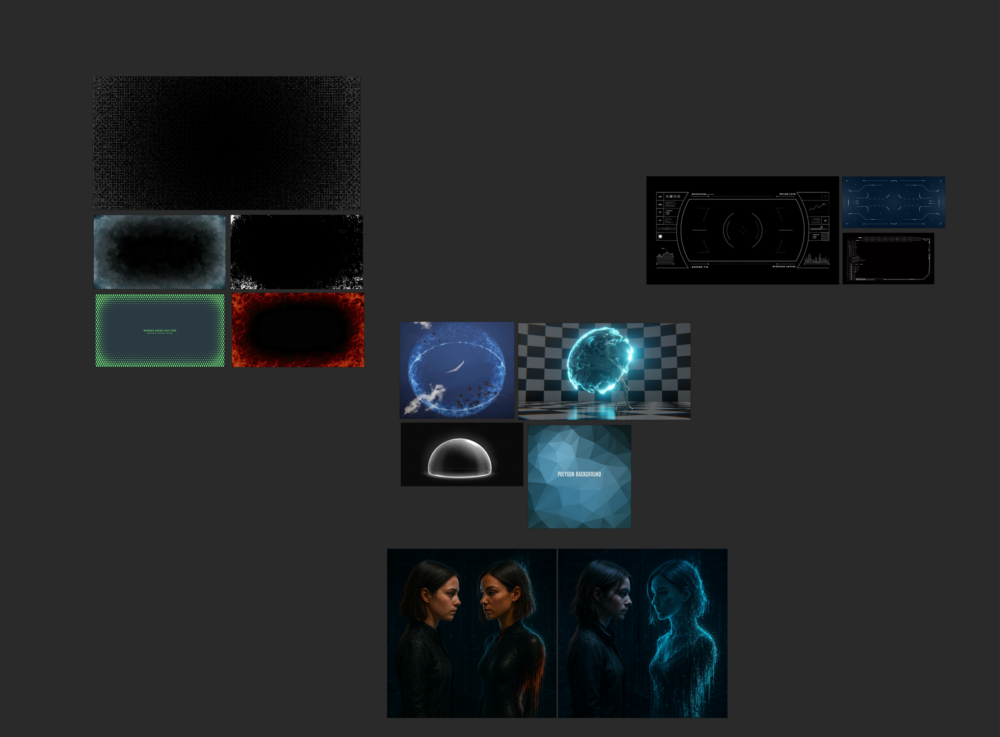 | 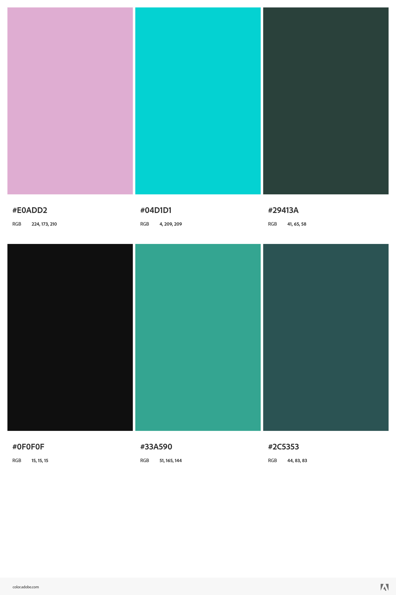 |

Colors from the scheme: `#E0ADD2` · `#04D1D1` · `#29413A` · `#0F0F0F` · `#33A590` · `#2C5353`

---

## Concept

The overlay should convey:

- **memory** – we are seeing something from the past
- **a digital world** – a non-human layer of perception
- **another dimension** – we are looking *through* something

That's why I didn't think of the overlay as a classic HUD, but as a **membrane or interface skin**. It doesn't chop up or distort the image underneath; it **filters** it.

**My idea:** a Voronoi texture that looks like skin / snakeskin:

- **Edge:** dense, hazy and glowing. Not a hard cut, but a radial transition (clear → hazy → almost opaque), slightly irregular instead of a perfect rectangle or circle.
- **Center:** transparent, so the memory itself stays visible.
- **Structure:** no uniform hexagons, but organic and technical at the same time, with irregular edges and cells of different sizes (associations: digital crystals, memory cells, neural fragments).
- **Look:** very delicate and *glowy*. The overlay itself is almost colorless; the color sits in the highlights on the cell edges (cyan / violet / pink, never pure white).
- **Motion:** minimal – a slow "breathing" and drifting rather than a typical tech animation.

---

## Work in Progress

| Shader node set up | Voronoi animation |
|---|---|
| 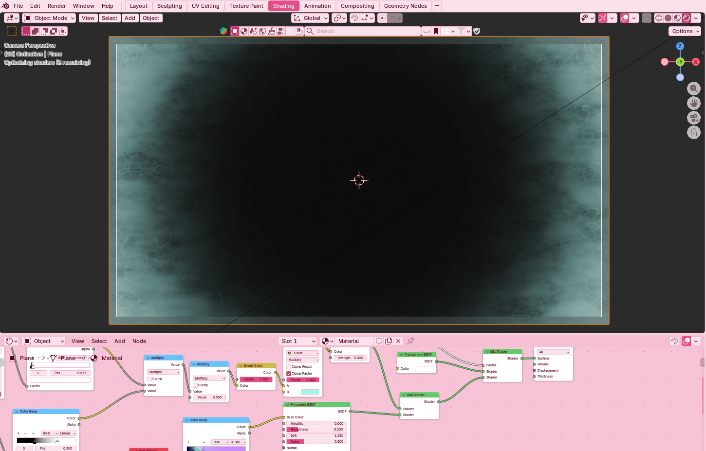 | 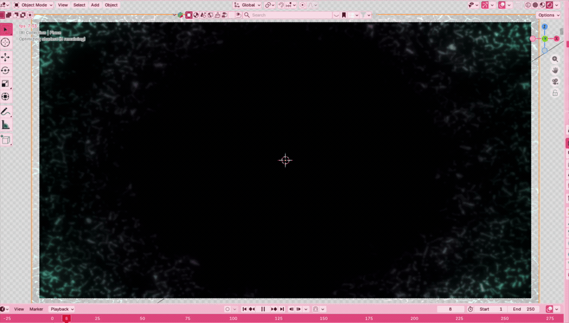 |

In the first version the edge was still a soft, milky vignette. The second added the Voronoi cells, at that point still green/teal and much coarser than in the final version.

---

## Implementation in Blender

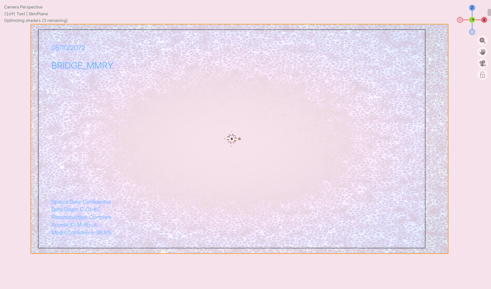

### Setup

The overlay is not just a compositor effect but its own **plane (`SkinPlane`) in front of the camera**. The camera looks through this membrane. This makes the shader feel spatial and gives the motion a slight parallax.

### "Skin" Shader

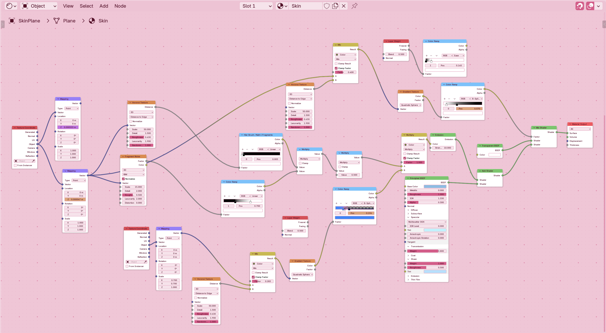

- **Cell structure:** Texture Coordinate → Mapping → **Voronoi Texture** (3D, *Distance to Edge*). A Noise Texture ("Fragment Noise") distorts the coordinates so the cells look organic instead of uniform. Several Voronoi layers at different scales are mixed together.
- **Edges:** Color Ramps turn the distance into sharp, thin cell edges.
- **Transparency towards the center:** A **Gradient Texture (Quadratic Sphere)** and **Layer Weight** control how visible the overlay is: denser and hazier towards the edge, transparent in the center.
- **Material:** Principled BSDF plus **Emission** on the cell edges (for the glow), mixed with a **Transparent BSDF**.

### Animation

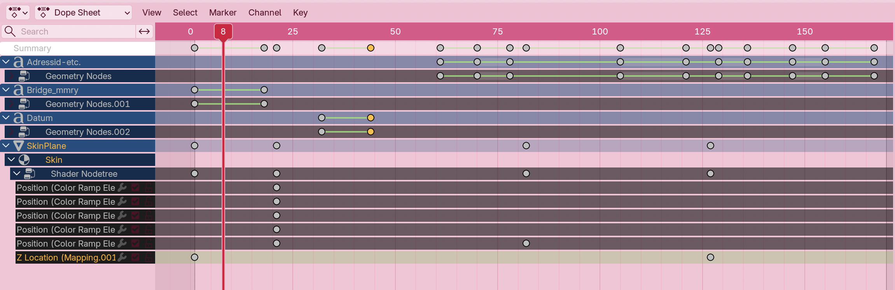

- **Skin:** Keyframes on the Color Ramp element positions make the skin "grow" in from the edge (build). An animated Z location in the Mapping node makes the cells drift very slightly (loop).
- **Text:** The text lines (`05/10/2072`, `BRIDGE_MMRY`, address/data lines) appear one after another, driven by **Geometry Nodes**.

### Compositing

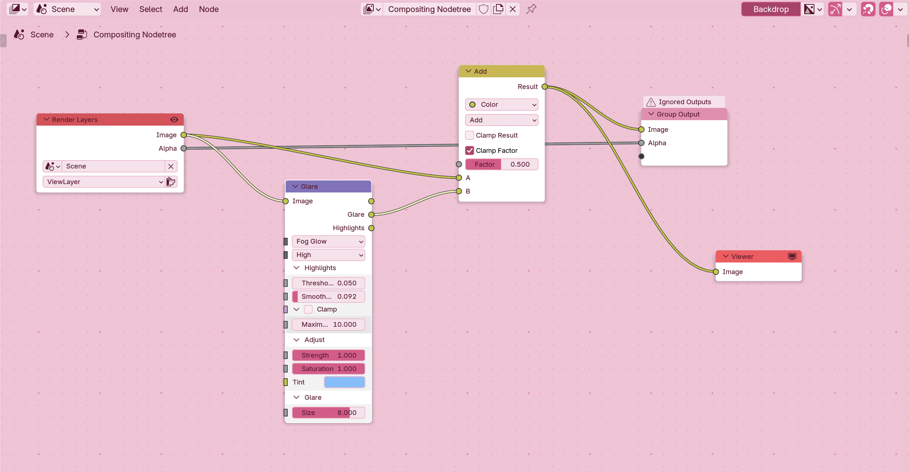

In the compositor a **Glare node (Fog Glow)** creates a soft glow, which is added on top of the image with an **Add** node. The alpha channel is passed through unchanged.

### Render Output

- **Format:** OpenEXR with alpha channel (RGBA), linear color space
- **Resolution:** 3840 × 2160
- **Frame rate:** 25 fps
- **Film → Transparent**, i.e. no black background

**Note for the compositing team was:** The overlay is meant for the **Add / Screen / Lighten** blend modes. The alpha is soft, not binary.

---

## Outcome

The result is three EXR sequences that are combined in the edit:

| Sequence | Frames | Duration | Content |
|---|---|---|---|
| `Skin-Build` | 0001–0250 | 10 s | The Voronoi skin builds up from the edge |
| `Skin-Loop` | 0251–0500 | 10 s | The finished skin "breathes" as a seamless loop |
| `Text-Build` | 0001–0170 | 6.8 s | The Bridge text overlays |

| Skin-Build | Skin-Loop | Text-Build |
|---|---|---|
| 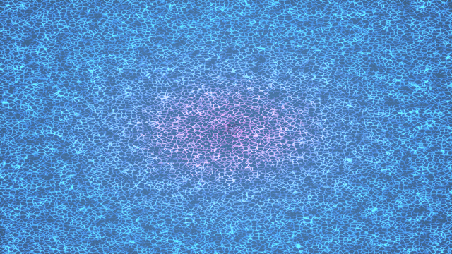 | 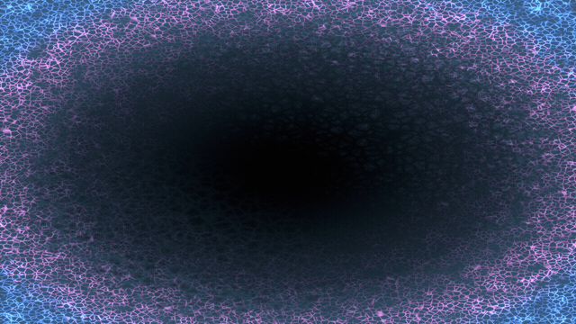 | 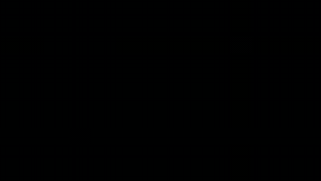 |

> The GIFs are scaled-down previews (640 px). Because GIF can't do semi-transparent pixels, they are shown on black. The original EXRs are 4K and transparent.

### Detail at Full Resolution

To show the fine cell structure, here is a frame from the skin loop in 4K, with the last frame of the text build on top:

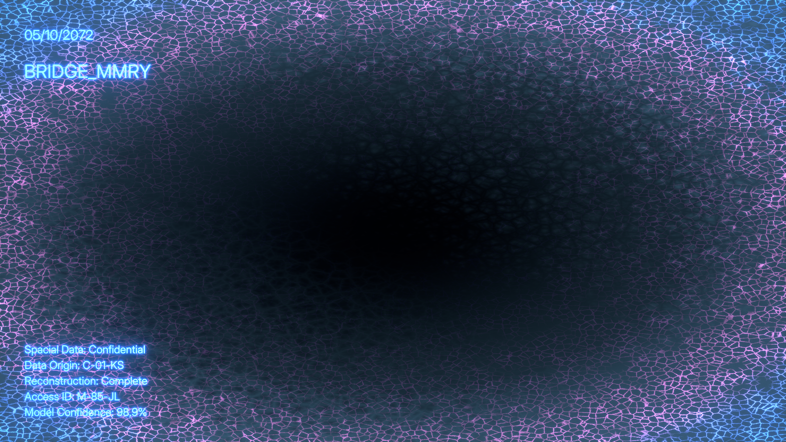

Crop at original size (1:1):

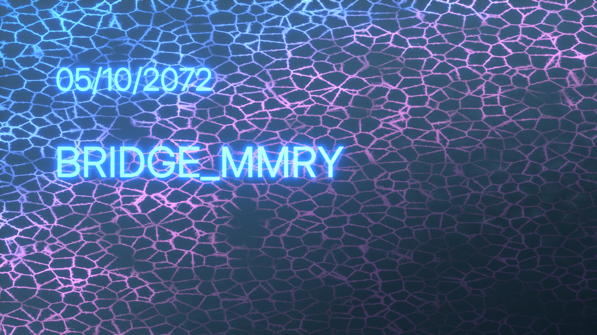

---

## Time Spent

| Date | Activity | Time |
|---|---|---|
| Fri, 12 Dec 2025 | Graphics meeting – Interconnection project | 1 h |
| Fri, 16 Jan 2026 | Interconnection (soft) | 1 h 15 min |
| Sat, 17 Jan 2026 | Interconnection (soft) | 1 h 15 min |
| Fri, 23 Jan 2026 | Interconnection meeting | 30 min |
| – | Independent work (concept, Blender build, animation, rendering) | 8 h |
| | **Total** | **12 h** |
